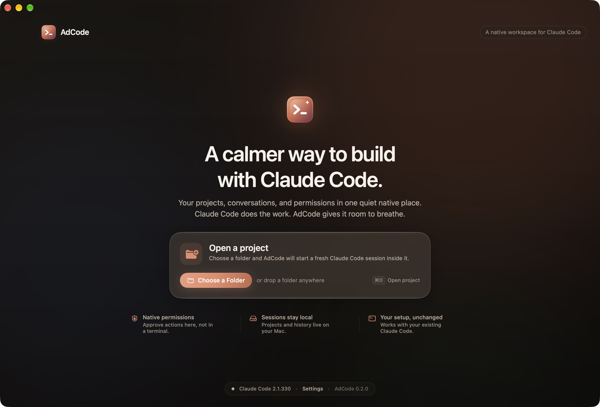
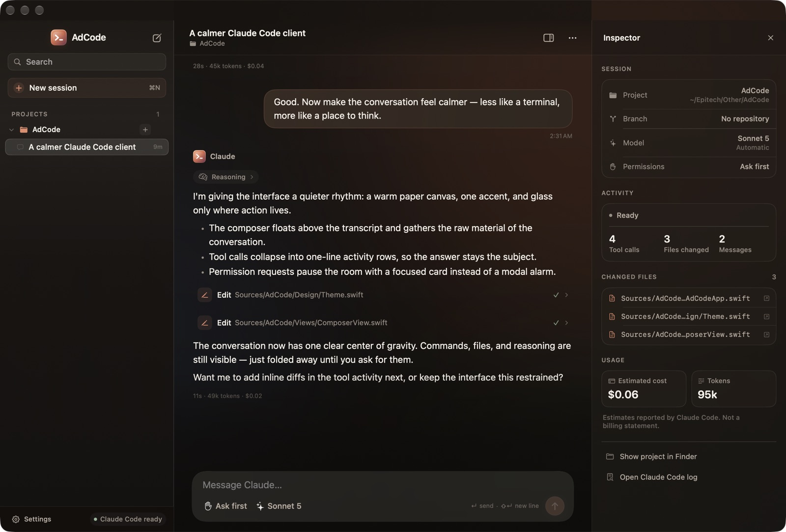
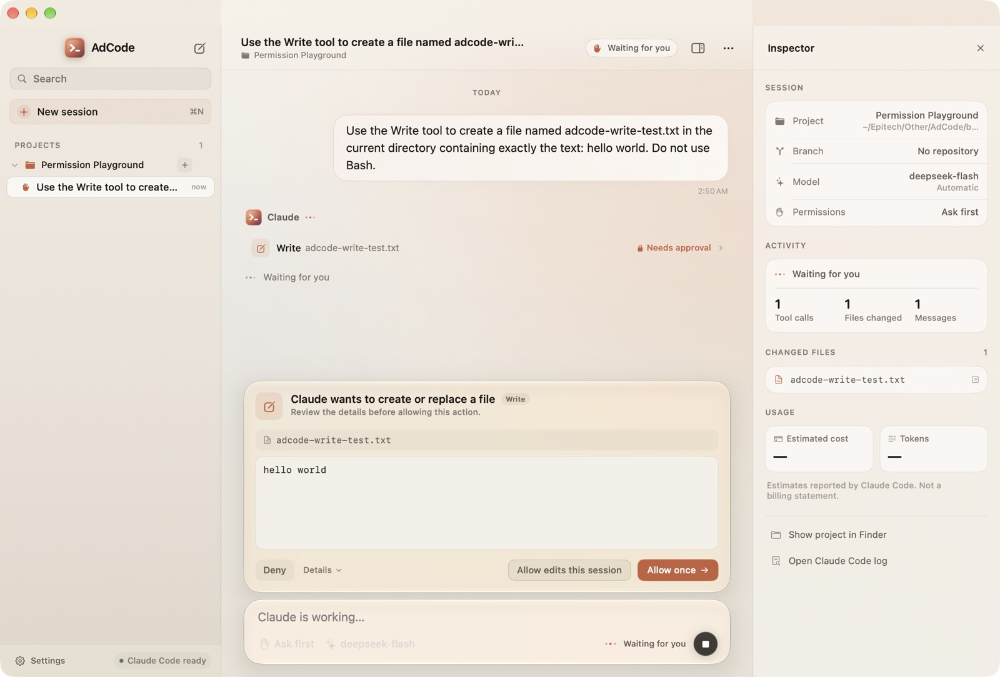
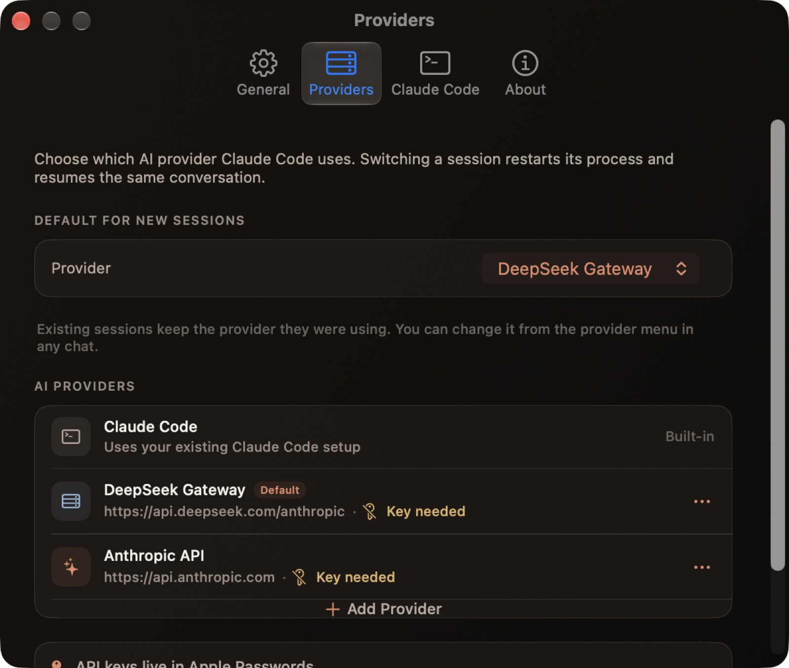

# Gantry

A native macOS workspace for **Claude Code** — built with SwiftUI and Liquid Glass. It runs Claude Code in the background and keeps the conversation, project context, streaming output, tool permissions, and AI provider choice in one calm window instead of a terminal.

**Gantry 0.4.1** adds optional Graphify knowledge graphs and an inspector view of sub-agent runs, with a round of review fixes.









## What's new in 0.4.1

- **Graphify knowledge graphs.** An optional local Graphify integration: the **Graphify** page builds or refreshes a project's code graph, opens the generated `graph.html`, and runs queries. Chats whose project has a built graph get the `graphify-mcp` server automatically, with no manual MCP setup. Installing Graphify requires an exact `uv` command and an explicit confirmation.
- **Sub-agent runs.** The inspector now lists every `Task`/`Agent` delegation with its type, description, live status, and duration. Selecting one shows the prompt Claude gave the sub-agent and its final report; background delegations are labelled.
- **Review fixes.** The context meter is sized from the model that produced the tokens, with unknown custom models assumed to have a 1M window. Commit pathspecs are literal per reviewed file and skip paths that became directories; conversation search normalizes repeated whitespace; number questions validate inline. `⌘0` reopens Gantry, and `CLAUDE_CODE_PATH` is honored alongside the existing override.

## What's new in 0.4.0

- **Context meter.** The composer shows how many prompt tokens Claude Code last reported, sized from the resolved model name — including `[1m]` variants — and warns as the window fills.
- **Attach files and folders.** Drag files onto the composer or use the paperclip. Attachments become removable chips and their paths are added to the prompt, with Claude's own Read permission still in charge.
- **Review & Ship.** A session review sheet gathers Claude's file edits with diffs and per-file notes. Notes go back to Claude as one message; **Commit…** commits only the reviewed project files, respects hooks and signing, and never pushes.
- **Search every conversation.** `⇧⌘F` searches titles, prompts, answers, commands, and file paths across every project and jumps directly to the matching turn.
- **Runs in the menu bar.** Closing the window hides Gantry without stopping Claude. The menu bar item shows pending requests, running sessions, and finished turns, and lets you allow or deny actions and answer questions without reopening the window.
- **Composer and window fixes.** Return sends, Shift-Return inserts a newline at the caret, and window dragging now uses a native drag surface instead of the SwiftUI background gesture.

## What's new in 0.3.5

- **Redesigned interface.** Warm neutral surfaces, one SF type scale, and a terracotta accent reserved for the selection rail, live work, focus, and the primary action. The sidebar and floating controls use Apple's real Liquid Glass (`glassEffect`, `GlassEffectContainer`, `.glass` buttons); content surfaces stay flat with hairlines.
- **Command picker scrolling.** Hovering a slash command or palette row highlights it without moving the list. Only keyboard navigation scrolls.
- **Slash-command picker.** Type `/` in the composer to search Claude Code's built-in commands, your own and project commands, and commands contributed by installed extensions and mods, with argument hints and descriptions.
- **`AskUserQuestion` answer sheet.** When Claude asks a structured question, the permission card becomes a step-by-step answer sheet with option buttons, an “Other” field, and text or number inputs.

## What's new in 0.2.0

- **Provider profiles** for Anthropic-compatible endpoints, with a default for new sessions and a provider menu in every chat.
- **Per-session provider switching** that resumes the same Claude Code conversation on the new backend.
- **Apple Passwords / macOS Keychain** storage for provider API keys. Keys are never written into Gantry's session file, logs, or command line.
- **Provider editor** with base URL, auth type, model mappings, and advanced environment variables.
- **Code-host plugins** for GitHub, GitLab, and Gitea. Connect accounts, browse pull requests, read CI checks, post comments, and create pull requests from a repository panel.
- **Extensions & Mods page.** Browse Claude Code plugin marketplaces, install/enable/disable/update/uninstall, favorite source repositories, and scaffold a new mod with validation and tests.
- **MCP tool bridge.** When a project's remote matches a connected plugin, Claude Code gets six repository-scoped tools for reading pull requests and checks, commenting, and creating pull requests. Code-host tokens stay in the app.
- **Appearance control** in **Settings → General** to follow macOS or pin Gantry to light or dark.
- **Automatic migration** from Gantry 0.1.0 state. Existing sessions continue on the built-in current Claude Code setup.

## What it does

- **One persistent Claude Code process per chat.** Each open session speaks the CLI's bidirectional `stream-json` protocol, so replies stream live and follow-up messages stay in the same Claude Code conversation.
- **Native permission prompts.** Claude Code's `can_use_tool` requests arrive as a focused glass card in the app. Allow once, allow for the session, or deny without ever touching a TUI. When Claude asks a structured question with `AskUserQuestion`, the card becomes an answer sheet that walks through the questions one at a time with Back/Next and clickable steps: pick one or several options, type an “Other” answer, or fill in text and number fields. Long questions and choices scroll within the card so the navigation and response buttons stay accessible.
- **AI provider menu.** Add Anthropic-compatible gateways as named providers, then switch the backend for any chat from the provider menu in its header. Existing conversations resume on the new provider. The built-in **Claude Code** provider keeps using your current CLI setup, so your existing DeepSeek configuration remains available without reconfiguring anything.
- **Code-host plugins.** Connect GitHub, GitLab, or Gitea accounts in **Settings → Code Hosts**, then open the repository panel from any chat. It detects the project's `origin` remote and can list open pull requests, inspect CI checks, post a comment, or create a pull request. When multiple accounts match a host, choose the one for the project. Matching plugins are also exposed to Claude Code as a scoped MCP server.
- **Extensions & mods.** A top-level page for the Claude Code plugin ecosystem: browse marketplaces, install and manage skills, commands, agents, hooks, MCP bundles, and UI mods, favorite source repositories, and create your own mod. Installed state stays with Claude Code's `claude plugin` CLI, so the same extensions work in the terminal. Installing third-party code always requires a trust review; marketplace-declared install commands need a separate explicit approval and are never auto-accepted. Changes apply to new chats, and running chats restart their Claude process after the current turn.
- **Graphify knowledge graphs.** If [Graphify](https://github.com/Graphify-Labs/graphify) is installed, Gantry gives each chat whose project has a built graph the local `graphify-mcp` server, so Claude can query the codebase graph without a manual MCP setup. The **Graphify** page in the sidebar builds or refreshes the code graph with `graphify update`, opens the generated `graph.html`, and runs `graphify query` inline. When Graphify is missing, the page offers the documented `uv tool install "graphifyy[mcp]"` command behind a confirmation sheet; Gantry never installs it silently. Graph building is local and code-only; documentation, PDF, image, and media extraction still uses Graphify's own `/graphify` workflow.
- **Slash commands, including extension and mod commands.** Type `/` in the composer to open a filtered list of the session's commands. The menu shows each command's argument hint and description, and labels commands contributed by an extension or mod. Arrow keys navigate; Return completes the highlighted command so you can add arguments. It runs immediately if the typed token exactly matches the highlighted command's name or alias. The catalog is requested from the chat's own Claude Code process, so project commands, installed plugins, and mods loaded with `--plugin-dir` appear without a first prompt. `/clear` starts a new Gantry session and `/rename` updates the displayed title, so the two commands that manage session identity stay in sync with Gantry's own state.
- **Context meter.** The composer shows how many prompt tokens Claude Code last reported, including cached context, as a quiet bar against the model's context window. The window size comes from the resolved model name that produced those tokens: a `[1m]` marker such as `deepseek-flash[1m]` means 1M, standard-window Anthropic generations use 200K, and unknown custom models assume 1M. It turns cautionary and then destructive as the window fills, so long conversations show when a compaction is near. Return sends and Shift-Return inserts a newline.
- **Attach files and folders.** Drag files or folders onto the composer, or use the paperclip. Attachments appear as removable chips and their absolute paths are added to the prompt, so Claude can read them with its normal tools and permissions. A prompt can be attachments alone, and dropping files highlights the composer with the same accent focus ring.
- **Review & Ship.** Open **Review changes** from the chat header, the inspector, or `⇧⌘R` to see every file Claude edited in one place. Each file keeps its changes in order with a native diff, line counts, and a note field; **Send notes** turns the notes into one focused message back to Claude. **Commit…** commits exactly the reviewed project files with your message, uses your Git signing and hooks normally, and never pushes.
- **Keys in Apple Passwords.** Provider API keys are written to the macOS Keychain as internet-password items, never to Gantry's session file, logs, or command line. When iCloud Keychain is available, they can sync through Apple Passwords. Keys can be entered, replaced, or removed from **Settings → Providers** and are shown as masked fields only.
- **Sessions that survive restarts.** Projects, chats, provider choice, model choice, and permission mode are stored locally. The Claude Code session ID is resumed automatically after relaunch.
- **Runs in the menu bar.** Closing the window hides Gantry but keeps Claude Code running. The menu bar item shows working sessions, finished turns, and requests that need you; its popover lets you allow or deny actions and answer Claude's questions without reopening the main window. **Open Gantry** restores the window; **Quit Gantry** or ⌘Q stops background work.
- **Real tool activity.** Bash, Read, Write, Edit, Task, web, MCP, and other tool calls appear as compact, inspectable rows. Expanded views show commands, file diffs, output, todos, and structured results.
- **Sub-agent visibility.** Every `Task`/`Agent` delegation appears in the inspector with its type, description, live status, and duration. Selecting one shows the prompt Claude gave the sub-agent and its final report. Background tasks are labelled because Claude Code reports their result later.
- **Model-aware cost estimates.** Turn and session costs are calculated from the reported model's published token pricing and actual usage, instead of relying on Claude Code's cost assumptions. Unknown models fall back to the estimate Claude Code reports. These are estimates, not billing data.
- **Search every conversation.** `⇧⌘F` searches session titles, prompts, answers, commands, and file paths across every project. Results show a snippet with the match highlighted; Return opens the session and scrolls to the matching turn. Queries ignore leading and trailing spaces and collapse runs of whitespace, so a path or phrase matches regardless of spacing. The sidebar field remains a quick filter for session names.
- **Workbench details.** A sidebar for projects and sessions, a command palette (`⌘K`), streaming Markdown with code highlighting and tables, a session inspector, and a model-aware estimated usage view.
- **A design that belongs on macOS.** SF typography, a warm neutral canvas, system/light/dark appearance, and Apple's Liquid Glass (`glassEffect` and `GlassEffectContainer`) for the sidebar and the floating controls. Content surfaces stay flat with hairlines instead of imitating glass. macOS 26 or later is required for the glass APIs.

## Requirements

- macOS 26 or newer
- Xcode 26/27 toolchain (Swift 6.2+)
- [Claude Code](https://docs.anthropic.com/en/docs/claude-code) installed and authenticated
  - Developed against Claude Code `2.1.330`
  - Gantry uses your existing Claude Code login, settings, model aliases, hooks, and MCP servers
  - Extension management requires a Claude Code version with the `claude plugin` commands
- Optional: [Graphify](https://github.com/Graphify-Labs/graphify) for project knowledge graphs. Gantry can install it with `uv` from the Graphify page.

## Build and run

```sh
./Scripts/build-app.sh          # release build with a generated app icon
open build/Gantry.app
```

The build is ad-hoc signed locally. If macOS quarantines a copied build, use Finder → Open on the app once.

To install:

```sh
cp -R build/Gantry.app /Applications/
```

For development, build and test the Swift package directly:

```sh
swift build
swift test
```

The package can also be opened as a package in Xcode. Use `Scripts/build-app.sh` when you need the bundled `.app` with its Info.plist and icon.

Optional integration tests:

```sh
# Spends a small amount of API credit against the installed CLI.
Gantry_RUN_CLI_INTEGRATION=1 swift test --filter realClaudeCodeSmokeTest
Gantry_RUN_CLI_INTEGRATION=1 swift test --filter realClaudeCodeReportsSlashCommands
Gantry_RUN_CLI_INTEGRATION=1 swift test --filter modScaffoldCLIValidation

# Writes and deletes disposable test items in the login Keychain.
Gantry_RUN_KEYCHAIN_TESTS=1 swift test --filter keychainRoundTrip
Gantry_RUN_KEYCHAIN_TESTS=1 swift test --filter pluginKeychainRoundTrip
```

## How it works

```
Gantry.app
├── SwiftUI shell        Sidebar, conversation, composer, permission and question cards, inspector
├── AppModel             Projects, sessions, providers, plugins, drafts, persistence, permissions
├── ClaudeRuntime        One child process per session
│       └── claude --input-format stream-json --output-format stream-json
│                   --permission-prompt-tool=stdio --include-partial-messages
└── PluginToolBridge     Per-session MCP tool socket
        └── Gantry-plugins (bundled MCP helper)
```

1. On the first message, Gantry spawns the `claude` CLI in the project folder with a session UUID.
2. It writes an `initialize` control request, then the user's prompt as `stream-json`.
3. CLI output is parsed into system, partial-text, assistant, tool-result, permission, and result events. Partial deltas are coalesced at roughly 30 fps so long answers do not redraw the UI per token.
4. A permission or question request pauses Claude Code until the user answers. The app sends a `control_response` with `behavior: allow` or `deny`; “allow for session” forwards Claude Code's own permission suggestions. For `AskUserQuestion`, the allow response carries an `updatedInput.answers` map keyed by question text.
5. On the next message the same process is reused. After an app restart, Gantry relaunches the CLI with `--resume <session-id>`.
6. The selected provider's environment — endpoint, model aliases, and credential — is injected into that child process only. Switching providers recycles the process after the current turn and resumes the same Claude Code transcript with the new environment.
7. If the project's `origin` remote matches a connected code-host plugin, Gantry starts a private per-session Unix-socket bridge and adds the bundled `Gantry-plugins` MCP server to that Claude process. Tool calls are scoped to that repository. The helper receives only the socket path and a random bridge token; the code-host access token stays in the app and is read from the Keychain for each tool call.

Permission modes map to Claude Code's own modes:

| Gantry | Claude Code |
| --- | --- |
| Ask first | `manual` (reported as `default`) |
| Auto-edit | `acceptEdits` |
| Plan | `plan` |
| Auto | `auto` |

Claude Code remains the authority on what needs approval. Its safety classifier, hooks, and permission rules still apply, and certain safe operations may proceed without a prompt.

## AI providers and Apple Passwords

Open the provider menu in the chat header to switch the current conversation, or go to **Settings → Providers** to manage profiles and choose the default for new sessions.

Each provider profile can set:

- An Anthropic-compatible base URL
- Authentication using an authorization token, an API key, or your existing Claude Code login
- Main, Opus, Sonnet, Haiku, and subagent model mappings
- Additional non-secret environment variables for that backend

API keys are stored as internet-password items in the login/iCloud Keychain. Gantry reads the key only when it needs to launch a Claude Code process and passes it through the process environment; it never includes the key in arguments or logs. If iCloud Keychain is unavailable to the local ad-hoc build, Gantry falls back to the local login keychain rather than storing the key insecurely.

The built-in **Claude Code** provider has no environment overrides and no Gantry-managed key. It uses your existing Claude Code authentication, settings, hooks, MCP servers, and model configuration exactly as the CLI does. The provider editor's **Fill from Claude Code** action imports only the non-secret base URL and model mappings from `~/.claude/settings.json`.

Provider switching is available while a chat is idle. A running turn finishes on its current provider; the new one is used for the next message.

## Code-host plugins

Gantry ships with three built-in plugins:

| Plugin | Works with | Repository actions |
| --- | --- | --- |
| GitHub | github.com and GitHub Enterprise | Pull requests, comments, check runs and commit statuses |
| GitLab | gitlab.com and self-hosted GitLab | Merge requests, notes, pipelines and jobs |
| Gitea | Gitea and Forgejo | Pull requests, comments and commit statuses |

Connect an account in **Settings → Code Hosts** with a personal access token. The token is verified against the instance's `/user` endpoint before it is stored as a Keychain internet password; it is never shown again and never written to Gantry's state file or logs.

A repository panel is available from the branch button in a chat header. It reads the project's `origin` remote, finds a plugin connected to that host, and shows open pull requests or merge requests. From the panel you can:

- Inspect CI checks and open their logs
- Post a conversation comment on a pull request or merge request
- Create a new pull request or merge request from two branches
- Open the repository or an individual change on the code host
- Choose which connected account to use when more than one matches the remote

### Claude Code MCP bridge

When a project's `origin` remote matches a connected plugin, the next Claude Code process for that chat is launched with a bundled MCP server named `Gantry_plugins`. The server exposes:

- `get_repository`
- `list_pull_requests`
- `get_pull_request`
- `list_checks`
- `comment_on_pull_request`
- `create_pull_request`

The tools are scoped to the project's repository. They run through a private Unix domain socket back into the Gantry app, which reads the Keychain token and performs the API request. The MCP helper receives only the socket path and a random bridge token — never the code-host token. MCP configuration and socket files use user-only permissions and are removed when the runtime stops.

Repository-panel actions are started by you. MCP actions are requested by Claude and follow Claude Code's normal permission prompts; the appended system prompt instructs Claude to post comments or create pull requests only when you explicitly ask or approve. The AI provider credentials and code-host credentials remain separate.

Suggested token scopes are shown in the connection editor. GitHub needs repository access plus pull-request, issue, and checks access; GitLab needs the `api` scope; Gitea needs repository and issue read/write access. Use the narrowest scope that fits your workflow. HTTPS is recommended for every remote instance. HTTP connections to local hosts are allowed; App Transport Security may reject HTTP for public hostnames.

## Extensions and mods

The **Extensions & Mods** page in the sidebar (or `⇧⌘E`) manages the Claude Code plugin ecosystem: skills, commands, agents, hooks, MCP bundles, and UI mods.

- **Browse** the marketplaces already configured in Claude Code. Install, enable, disable, update, and uninstall extensions. A trust sheet shows the marketplace and source and warns that extensions can add code that runs with your permissions. If a marketplace declares an install command, Gantry shows the exact command and its SHA-256 and requires a second explicit approval; it never passes `-y` or accepts the command automatically.
- **Installed** lists plugins with their scope and settings status. Gantry manages user-scope plugins; project/local-scope entries are shown read-only because their state belongs to a project.
- **Sources** adds marketplace repositories by `owner/repo`, git or HTTPS URL, or local path. Repositories can be favorited and sort first in Browse and Sources. Removing a source does not uninstall plugins already installed from it.
- **Create** scaffolds a valid mod from a status-line, slash-command, pane, tool-guard, or blank template. It writes `.claude-plugin/plugin.json`, a hooks module, a README, and, when its test option is enabled for a pane, a starter test; runs `claude plugin validate` (and optionally `claude plugin test`); and can open the folder in Gantry, where the project's chats load it with `--plugin-dir`.
- Installed plugin state belongs to Claude Code's `claude plugin` commands, so extensions installed here also work in the terminal. Gantry stores only favorite marketplace repositories and the last mods folder. After a plugin change, idle Claude processes are recycled and running chats pick up the change after their current turn.
- Commands contributed by installed plugins and by mods loaded with `--plugin-dir` appear in the composer's `/` picker beside built-in and user commands. The picker's catalog is refreshed when a chat's Claude process restarts after an extension change.

## Storage and privacy

- Session data: `~/Library/Application Support/Gantry/state.json` (mode `0600`)
- Claude Code stderr logs: `~/Library/Logs/Gantry/` (files mode `0600`)
- Provider API keys: macOS Keychain / Apple Passwords internet-password items. They are not stored in Gantry's session data.
- Code-host access tokens: macOS Keychain internet-password items, one per plugin connection. Code-host metadata and project-to-plugin choices are stored in `state.json`; tokens are not.
- Extension management: installed plugin and marketplace state lives in Claude Code's own directories. Gantry stores only favorite marketplace repositories (name + source key) and the last mods folder in `state.json`.
- MCP runtime configs and sockets: temporary files with user-only permissions. The MCP config contains a random bridge token and a socket path, never a code-host token. Both are removed when the Claude runtime stops.
- A corrupt state file is copied aside as `state-unreadable-<timestamp>.json` before the app can overwrite it.
- Claude Code's own OAuth credentials remain managed by Claude Code.
- Project files are not copied into the app. Claude Code works in the folder you select. Gantry is intentionally not App-Sandboxed because it launches your CLI and opens the folders you choose; review the source before running it on sensitive machines.
- The debug/test environment variable `Gantry_STATE_DIR` can redirect app state to another folder. `Gantry_CLAUDE_PATH` can point at a specific CLI executable.

## Current limits

- Single main window with a menu bar extra, macOS 26+ only.
- Provider switching applies between turns; it is disabled while a response is in flight.
- Provider profiles are per session and remembered. Existing sessions keep their provider when the default changes.
- Code-host plugins use personal access tokens; there is no browser-based OAuth flow.
- Extension management is user-scope only. Project/local-scope plugins are shown read-only. Inline plugin configuration for extensions that declare user settings is not exposed yet; Gantry shows a copyable `claude plugin configure` command instead.
- Extension changes require restarting the chat's Claude process; Gantry recycles idle processes immediately and running chats after their current turn.
- The repository panel and MCP tools expose open pull requests, conversation comments, CI checks, and pull-request creation. Inline review threads, merging, and dispatching CI workflows are not included; checks are read-only.
- Code-host features need an `origin` remote. When several accounts match a host, the selected account is remembered per project.
- The MCP bridge is scoped to one repository and requires the bundled `Gantry-plugins` helper, which the provided build script includes. It is only active when the chat's Claude Code process starts with a matching plugin; changing code hosts recycles idle runtimes.
- Graphify is optional and not bundled. Gantry finds an existing install on `PATH` or in `~/.local/bin`, `/opt/homebrew/bin`, or `/usr/local/bin`. With `uv` available, the Graphify page can install `graphifyy[mcp]` after a confirmation sheet; without it, the page shows the command for Terminal.
- The Graphify page builds code graphs with `graphify update`, which is local and does not call a model. Doc, PDF, image, audio, and video extraction still needs Graphify's `/graphify` skill in a chat. The generated files live in the project's `graphify-out/` folder.
- Graph MCP tools appear when a chat starts. After building a graph or installing Graphify, idle chats recycle immediately; a running chat picks up the tools after its next turn. **Open Graph** opens the generated `graph.html` in the default browser.
- Image attachments and MCP elicitation UI are not supported. File and folder paths can be attached from the composer, and standard permission prompts and `AskUserQuestion` dialogs are supported.
- The context meter estimates the window from the resolved model name. Providers that report an unrecognized model name are assumed to have a 1M window.
- **Commit…** requires the project folder to be a Git working tree. If Git is unavailable or the folder is not a repository, the sheet shows Git's error and commits nothing.
- Conversation search scans the loaded session history in memory; there is no on-disk index, so very large histories take longer to search.
- Slash commands whose interface is terminal-only, such as prompt-bar color or focus mode, run through Claude Code but have no visual effect in Gantry. `/clear` starts a new Gantry session and `/rename` changes the session title.
- **Sub-agent details cover the Task/Agent call**, not its internal tool calls: type, description, status, timing, prompt, and final report. Background sub-agents (`run_in_background`) report a task id instead of a report and are labelled as background.
- Files edited via Bash are not listed in the inspector's edited-files list (only file-editing tools such as Edit, MultiEdit, Write, and NotebookEdit are).
- Idle Claude Code processes stay alive while the app is open, which keeps follow-ups fast at the cost of memory.
- If iCloud Keychain sync is unavailable (for example an ad-hoc local build), keys stay in the local login Keychain.
- The app is an unofficial client and is not affiliated with Anthropic.

## Project map

```
Sources/GantryCore/
  Models.swift          Codable project, session, turn, tool, and settings models
  AIProvider.swift      Provider profiles, auth modes, model and env mapping
  ProviderKeychain.swift Apple Passwords/Keychain credential storage
  Plugins.swift         Code-host plugin models, remotes, and git config reading
  PluginKeychain.swift  Code-host token storage
  CodeHostClient.swift  HTTP transport, errors, and shared plugin client
  GitHubPlugin.swift    GitHub REST implementation
  GitLabPlugin.swift    GitLab REST implementation
  GiteaPlugin.swift     Gitea REST implementation
  PluginTools.swift     MCP tool catalog, wire format, and executor
  PluginToolBridge.swift Private Unix-socket bridge for MCP tool calls
  ClaudePluginManager.swift Claude Code plugin/marketplace CLI models and manager
  SlashCommands.swift   Slash-command catalog parsed from the initialize handshake
  ModScaffolder.swift   Mod templates, name validation, and file generation
  ClaudeEvents.swift    Stream protocol types and JSON line parser
  ClaudeQuestionnaire.swift AskUserQuestion schema parsing and answers
  ClaudeWire.swift      Outgoing user, control, and permission messages
  ClaudeRuntime.swift   Process lifecycle, stream framing, control handshake, logging
  ClaudeLocator.swift   CLI discovery and launch arguments
  AppDataStore.swift    Local state and log paths
  MarkdownParser.swift  Dependency-free block Markdown parser
  ModelPricing.swift    Published per-model pricing and model-aware cost estimation
  ModelContextWindow.swift Context-window sizes used by the composer's context meter
  SessionReview.swift   Completed file edits aggregated for review and Claude notes
  SessionSearch.swift   In-memory full-text search over titles, turns, and tool paths
  PromptAttachments.swift Composer file/folder attachments and prompt composition
  GitCommit.swift       Pathspec staging and commit service; never pushes or bypasses hooks
  Graphify.swift        Graphify detection, MCP server entry, status, commands, and process runner
Sources/Gantry/
  App/                  App entry, observable state, providers, plugins, extensions, Graphify install/build state, MCP bridge lifecycle, conversation, review, search, and menu bar state
  Design/               Palette, type scale, surface and glass helpers, brand mark, shared controls
  Utilities/            Inline Markdown, syntax highlighting, tool and provider presentation
  Views/                Welcome, sidebar, conversation, composer, permissions and questions, inspector, settings, provider editor, code-host settings, repository panel, extensions and mods, Graphify page, conversation search, sub-agent details, review changes, menu bar extra
Sources/GantryPluginMCP/
  main.swift            Bundled stdio MCP server; forwards tool calls to the app
Scripts/
  build-app.sh          SwiftPM build → Gantry.app bundle (including the MCP helper) + icon + ad-hoc signature
  generate-icon.swift   Resolution-independent app icon renderer
```

## Verification

- `swift test` — tests covering protocol parsing/serialization, runtime permission flow with a fake CLI, `AskUserQuestion` parsing and answers, provider environment injection, model-aware cost estimation, context-window sizing, prompt attachment composition, session review and literal-pathspec commits, conversation search normalization, Graphify detection and MCP wiring, Graphify command construction and its shell-free process runner, plugin remote parsing and REST fixtures, MCP tool execution and the Unix-socket bridge, Claude Code plugin catalog/command parsing, slash-command catalog parsing and matching, favorites, mod scaffolding, Markdown, persistence, and 0.1.0 state compatibility.
- Extension scaffolding can be validated against the real CLI:
  ```sh
  Gantry_RUN_CLI_INTEGRATION=1 swift test --filter modScaffoldCLIValidation
  ```
- The bundled MCP helper was exercised with a local Unix-socket harness, and Claude Code was verified to launch it from the generated MCP configuration without sending a model prompt.
- Keychain round-trip tests are gated:
  ```sh
  Gantry_RUN_KEYCHAIN_TESTS=1 swift test --filter keychainRoundTrip
  Gantry_RUN_KEYCHAIN_TESTS=1 swift test --filter pluginKeychainRoundTrip
  ```
  Each uses and removes a disposable test item.
- Real Claude Code smoke test and the slash-command catalog handshake pass against the installed CLI.
- Debug and release app bundles build successfully; UI checked in light and dark appearance on macOS 27.

## Contributing

Bug reports, feature requests, and pull requests are welcome. Read [CONTRIBUTING.md](CONTRIBUTING.md) first, and use the issue and pull request templates so reports include what is needed to reproduce them. Report security issues privately through GitHub's Security tab rather than in a public issue.

## License

Gantry is source-available under the [Gantry Community License 1.0.0](LICENSE). You can use, modify, and share it freely, including inside a company. You may not sell it or ship it as part of a paid product or service, and you must credit **Gantry by Adrien Marette** with a link to this repository whenever you distribute it or a modified version.

Gantry is an unofficial client and is not affiliated with Anthropic.
